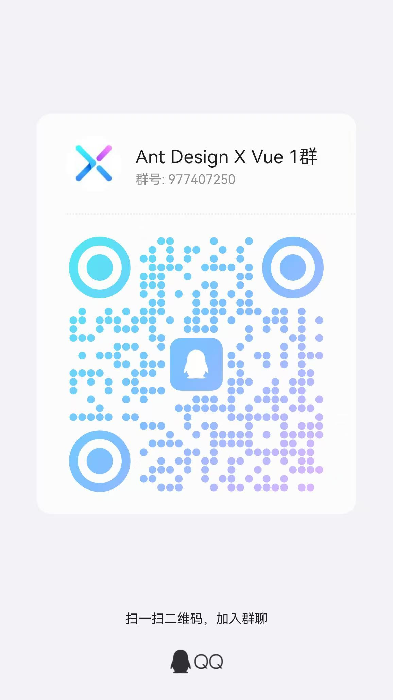

# Ant Design X Vue

[![npm version][npm-version-src]][npm-version-href]
[![npm downloads][npm-downloads-src]][npm-downloads-href]
[![bundle][bundle-src]][bundle-href]
[![Github Actions][github-actions-src]][github-actions-href]
![Netlify Build][netlify-build-src]
[![License][license-src]][license-href]

[![jsDelivr][jsdelivr-src]][jsdelivr-href]

Ant Design X For Vue. 🔥 [中文](./README.md)

This is the implementation of [Ant Design X](https://github.com/ant-design/x) for Vue.

## ✨ Features

- 🌈 Built on the RICH interaction paradigm, delivering an exceptional AI interaction experience.
- 🧩 Covers most AI dialogue scenarios, empowering you to quickly build personalized AI interaction interfaces.
- ⚡ Easily connect with inference services compatible with OpenAI standards.
- 🔄 Provides powerful tools for managing data flows, enhancing development efficiency.
- 📦 Offers multiple templates for quickly starting LUI application development.
- 🛡 Developed with TypeScript, ensuring robust type coverage to improve the development experience and reliability.
- 🎨 Supports fine-grained style adjustments to meet diverse use cases and personalization needs.

## 📦 Install

```bash
$ npm i ant-design-vue ant-design-x-vue
```

```bash
$ yarn add ant-design-vue ant-design-x-vue
```

```bash
$ pnpm add ant-design-vue ant-design-x-vue
```

## 🔨 Usage

```html
<script setup lang="ts">
import { Bubble, XProvider } from 'ant-design-x-vue';
</script>

<template>
  <Bubble content="Hello AI" />
</template>
```

## ⌨️ Development

```bash
# install dependencies
$ pnpm install

# develop library by docs demo
$ pnpm docs:dev

# build library source code
$ pnpm run build

# build docs code
$ pnpm run docs:build

# Locally preview the production build.
$ pnpm run docs:preview

# Lint
$ pnpm lint
```

## 🔗 Links

* [Vue](https://vuejs.org/)

* [Ant Design Vue](https://www.antdv.com/)

* [Ant Design X Of React](https://x.ant.design/)

## 🤝 Contributing

Would you like to change the world with us?

Please reference the [Roadmap](https://github.com/wzc520pyfm/ant-design-x-vue/issues/1) and pick up any one you like.

## 👥 Contributors


<a href="https://openomy.app/github/wzc520pyfm/ant-design-x-vue" target="_blank" style="display: block; width: 100%;" align="center">
  
 </a>


<a href="https://github.com/wzc520pyfm/ant-design-x-vue/graphs/contributors">
  
</a>

## 💬 Contact Us

| Wechat Public Account                                         | QQ Group                                                               |
| ------------------------------------------------------------- | ---------------------------------------------------------------------- |
|  |  |

## 📄 LICENSE

[MIT](./LICENSE)

<!-- Badges -->

[npm-version-src]: https://img.shields.io/npm/v/ant-design-x-vue.svg?style=flat
[npm-version-href]: https://npmjs.com/package/ant-design-x-vue
[npm-downloads-src]: https://img.shields.io/npm/dm/ant-design-x-vue.svg?style=flat
[npm-downloads-href]: https://npmjs.com/package/ant-design-x-vue
[bundle-src]: https://img.shields.io/bundlephobia/minzip/ant-design-x-vue?style=flat
[bundle-href]: https://bundlephobia.com/result?p=ant-design-x-vue
[github-actions-src]: https://img.shields.io/github/actions/workflow/status/wzc520pyfm/ant-design-x-vue/ci.yml?branch=main&style=flat
[github-actions-href]: https://github.com/wzc520pyfm/ant-design-x-vue/actions?query=workflow%3Aci
[netlify-build-src]: https://img.shields.io/netlify/fa0d6f03-f6b0-4342-8fe9-83ca3a6e063e
[license-src]: https://img.shields.io/github/license/wzc520pyfm/ant-design-x-vue?style=flat
[license-href]: https://github.com/wzc520pyfm/ant-design-x-vue/blob/main/LICENSE
[jsdelivr-src]: https://data.jsdelivr.com/v1/package/npm/ant-design-x-vue/badge
[jsdelivr-href]: https://www.jsdelivr.com/package/npm/ant-design-x-vue
