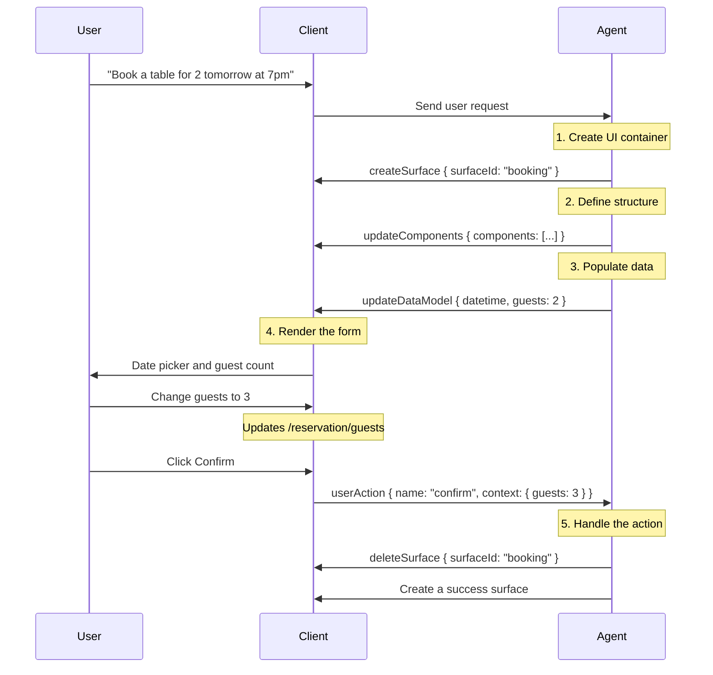

# X Card

`@ant-design-x-vue/x-card` is the Vue port of React [`@ant-design/x-card`](https://www.npmjs.com/package/@ant-design/x-card).

Drive dynamic cards with an A2UI command queue: `Box` holds the component registry and commands, `Card` renders a surface by `id` (`surfaceId`).

> 中文：[介绍](/x-card/introduce)

This page covers v0.9 rendering, path binding, action-context resolve, field write-back / validation, plus the React 2.10 showcase set: multi-card sync, filter-search, nested interaction, and progressive loading. v0.8 uses `surfaceUpdate` / `dataModelUpdate` / `beginRendering`.


## What is A2UI?

A2UI (Agent-to-User Interface) is an open protocol: an AI agent describes interaction intent as declarative JSON messages, and the client renders them as **native** UI components. `@ant-design-x-vue/x-card` is the Vue implementation of that protocol.

### Design principles

1. **Streaming messages**: UI updates flow from the agent as a sequence of JSON commands
2. **Declarative components**: the UI is data, not generated code
3. **Data binding**: structure is decoupled from state so updates stay reactive

### Why A2UI instead of LLM-generated HTML?

| Feature | A2UI | AI-generated HTML |
| --- | --- | --- |
| **Security** | Only the pre-registered catalog can render; no arbitrary code | Scripts and injection risk |
| **Cross-platform** | One payload maps to web or native widgets | HTML needs extra adaptation |
| **Streaming** | Progressive rendering | Usually waits for a full document |
| **LLM-friendly** | Flat JSON, incremental patches | Full HTML is easy to break |
| **Maintenance** | Update the client catalog | Debug every HTML snippet |

## Data flow

```
Agent (LLM) → A2UI generator → transport (SSE / WebSocket / A2A)
                    ↓
Client (stream reader) → parser → XCard renderer → native Vue components
```

Restaurant-booking example:



## Protocol versions

`@ant-design-x-vue/x-card` supports A2UI v0.8 and v0.9. Prefer **v0.9** for new work.

### Comparison

| Feature | v0.8 | v0.9 |
| --- | --- | --- |
| **Version field** | None | `version: 'v0.9'` on every command |
| **Surface creation** | Implicit | Explicit `createSurface` |
| **Data updates** | Often a `contents` array | `path` + `value` |
| **Component tree** | Easier to nest | Flat adjacency list |
| **Recommendation** | Compatibility only | **Recommended** |

Vue v0.8 demos also show `surfaceUpdate` / `dataModelUpdate` (including `valueString` / `literalString`) / `beginRendering`.

### v0.8 (compat)

```ts
{
  updateComponents: {
    surfaceId: 'booking',
    catalogId: 'https://example.com/catalogs/booking/v1/catalog.json',
    components: [
      { id: 'root', component: 'Column', children: ['header', 'content'] },
    ],
  },
}

{
  updateDataModel: {
    surfaceId: 'booking',
    contents: [{ op: 'replace', path: '/reservation/guests', value: 3 }],
  },
}
```

### v0.9 (recommended)

```ts
{ version: 'v0.9', createSurface: { surfaceId: 'booking', catalogId: 'https://example.com/catalogs/booking/v1/catalog.json' } }

{ version: 'v0.9', updateComponents: { surfaceId: 'booking', components: [
  { id: 'root', component: 'Column', children: ['header', 'content'] },
] } }

{ version: 'v0.9', updateDataModel: { surfaceId: 'booking', path: '/reservation/guests', value: 3 } }
```

### Migration

1. Add `version: 'v0.9'` to every message
2. Send `createSurface` before `updateComponents` (move `catalogId` there)
3. Replace `contents: [{ op, path, value }]` with `{ path, value }`
4. v0.9 can write a whole object in one message:

```ts
{
  version: 'v0.9',
  updateDataModel: {
    surfaceId: 'booking',
    path: '/reservation',
    value: { date: '2025-12-16', guests: 2 },
  },
}
```

The renderer detects the protocol from the presence of `version`. `commands` is `(XAgentCommand_v0_8 | XAgentCommand_v0_9)[]`.

## Core commands (v0.9)

### createSurface

Each surface has its own component tree and data model.

```ts
{ version: 'v0.9', createSurface: { surfaceId: 'booking', catalogId: 'my-catalog' } }
```

### updateComponents

Flat adjacency list. Exactly one `id: 'root'` per surface. Children are id strings — never nest component objects.

```ts
{
  version: 'v0.9',
  updateComponents: {
    surfaceId: 'booking',
    components: [
      { id: 'root', component: 'Column', children: ['header', 'guests-field', 'submit-btn'] },
      { id: 'header', component: 'Text', text: 'Confirm reservation', variant: 'h1' },
      { id: 'guests-field', component: 'TextField', label: 'Guests', value: { path: '/reservation/guests' } },
      {
        id: 'submit-btn',
        component: 'Button',
        action: { event: { name: 'confirm', context: { details: { path: '/reservation' } } } },
      },
    ],
  },
}
```

### updateDataModel

```ts
{ version: 'v0.9', updateDataModel: { surfaceId: 'booking', path: '/reservation', value: { datetime: '2025-12-16T19:00:00Z', guests: 2 } } }
```

### deleteSurface

```ts
{ version: 'v0.9', deleteSurface: { surfaceId: 'booking' } }
```

## Data binding

Each surface has its own JSON model. Paths are RFC 6901 JSON Pointers (`/user/name`).

```ts
{ id: 'title', component: 'Text', text: 'Welcome' }
{ id: 'username', component: 'Text', text: { path: '/user/name' } }
{ id: 'name-input', component: 'TextField', value: { path: '/form/name' } }
```

Two-way inputs must use `{ path }`. Literals do not write back. Custom Vue fields call injected `onDataChange(path, value)` or `useXCardField`.

## Actions

User events are resolved by Card and delivered through Box’s `onAction` prop (bind **`:on-action`** in templates — it is a prop, not an emit).

```ts
action: {
  event: {
    name: 'confirm_booking',
    context: {
      date: { path: '/reservation/datetime' },
      guests: { path: '/reservation/guests' },
    },
  },
}
```

`{ path }` entries become `{ value }` in `ActionPayload.context` (other keys such as `label` are kept). Payload shape: `{ name, surfaceId, context }`. v0.8 often uses `action.context` as `{ key, value: { path } }[]`.

## Catalog

A catalog lists allowed components and their JSON Schema. Implementation names must start with an **uppercase** letter. Call `registerCatalog` before mount and pass a stable `components` map to `XCard.Box`.

Helpers: `loadCatalog(catalogId)`, `validateComponent(catalog, name, props)`, `clearCatalogCache()`.

## Quick start

```vue
<script setup lang="ts">
import { XCard, registerCatalog } from '@ant-design-x-vue/x-card'
import type { XAgentCommand_v0_9, Catalog, ActionPayload } from '@ant-design-x-vue/x-card'

const catalog: Catalog = {
  catalogId: 'my-app-catalog',
  components: {
    Text: { type: 'object', properties: { text: { type: 'string' } }, required: ['text'] },
    Button: { type: 'object', properties: { text: { type: 'string' }, action: {} }, required: ['text'] },
  },
}
registerCatalog(catalog)

const commands: XAgentCommand_v0_9[] = [
  { version: 'v0.9', createSurface: { surfaceId: 'booking', catalogId: 'my-app-catalog' } },
  {
    version: 'v0.9',
    updateComponents: {
      surfaceId: 'booking',
      components: [
        { id: 'root', component: 'Column', children: ['title'] },
        { id: 'title', component: 'Text', text: 'Hello' },
      ],
    },
  },
]

const cardComponents = { /* Vue implementations of Text, Button */ }

function handleAction(payload: ActionPayload) {
  console.log(payload.name, payload.context)
}
</script>

<template>
  <XCard.Box :commands="commands" :components="cardComponents" :on-action="handleAction">
    <XCard.Card id="booking" />
  </XCard.Box>
</template>
```

See the Vue skill at `packages/x-skill/skills/x-card` and the [A2UI docs](https://a2ui.org/concepts/data-flow/), [component structure](https://a2ui.org/concepts/component-structure/), and [data binding](https://a2ui.org/concepts/data-binding/).

## Install

```bash
pnpm add @ant-design-x-vue/x-card
```

## Examples

### Basic

::::demo-v2 Register a local catalog and render a Text card with v0.9 commands.

x-card/basic

::::

### Action context resolve

::::demo-v2 Typing writes into the dataModel. A submit button may send an empty context; Card resolves `{ path }` entries in `action.event.context`.

x-card/action-context

::::

### Streaming / incremental JSON

::::demo-v2 Append `updateDataModel` commands to stream incomplete text and lists into the same surface.

x-card/streaming

::::

### Form field validation

::::demo-v2 Custom fields use `useXCardField` for required / format checks and write back through the injected `onDataChange`.

x-card/form-validation

::::

### Multi-card sync

::::demo-v2 The product list and cart bind the same `/cart`. `onAction` appends `updateDataModel` so both cards refresh — no extra cross-surface protocol.

x-card/multi-card-sync

::::

### Filter search

::::demo-v2 Filters are written to `/filters`. The list reads that path and filters locally.

x-card/filter-search

::::

### Nested interaction

::::demo-v2 Clicking a file writes the selection into the dataModel. The detail card binds `/selectedFile`.

x-card/nested-interaction

::::

### Progressive loading

::::demo-v2 Batched `updateComponents` appends product nodes. The progress bar is a `LoadingIndicator` driven by props; enter animation stays inside the card with CSS.

x-card/progressive

::::

### v0.8 basic render

::::demo-v2 `surfaceUpdate` + `dataModelUpdate` (`valueString` / `literalString`) + `beginRendering`.

x-card/v08-basic

::::

### v0.8 action context

::::demo-v2 v0.8 `action.context` is `{ key, value: { path } }[]`. Input writes the dataModel; an empty-context submit is resolved by Card.

x-card/v08-action

::::

## API

### XCard.Box

| Prop | Description | Type | Default |
| --- | --- | --- | --- |
| commands | A2UI command queue | `(XAgentCommand_v0_9 \| XAgentCommand_v0_8)[]` | `[]` |
| components | Implementation map; names must be capitalized | `Record\<string, Component\>` | - |
| onAction | Fired when a card triggers an action | `(payload: ActionPayload) => void` | - |

### XCard.Card

| Prop | Description | Type | Default |
| --- | --- | --- | --- |
| id | surfaceId, matching the command `surfaceId` | `string` | - |

Custom components receive:

- `onAction(name, context)`: Card then runs versioned `extractDataUpdates` and resolves path refs in the action context
- `onDataChange(path, value)`: writes the current surface dataModel directly

### useXCardField

```ts
const field = useXCardField({
  path: '/form/email',
  onDataChange, // injected by Card
  rules: [{ required: true }, { pattern: /.+@.+/, message: 'Invalid email' }],
})
field.setValue(next)
field.validate()
field.error.value
```

`validateFieldValue(value, rules)` is also exported.

### Catalog helpers

- `registerCatalog(catalog)`
- `loadCatalog(catalogId)`
- `validateComponent(catalog, name, props)`
- `clearCatalogCache()`
