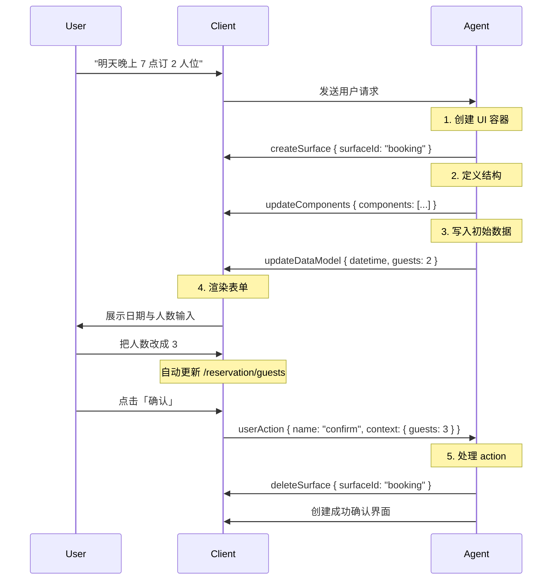

# X Card

`@ant-design-x-vue/x-card` 是 React [`@ant-design/x-card`](https://www.npmjs.com/package/@ant-design/x-card) 的 Vue 移植。

用 A2UI 命令队列驱动动态卡片：`Box` 提供组件注册表和命令，`Card` 按 `id`（surfaceId）渲染。

本页覆盖 v0.9 基础渲染、路径绑定、action context 解析、字段回写 / 校验，以及与 React 2.10 showcase 对齐的多卡同步、筛选搜索、嵌套交互、渐进加载。v0.8 用 `surfaceUpdate` / `dataModelUpdate` / `beginRendering` 的命令形状，也提供基础与 action 示例。


## 什么是 A2UI？

A2UI（Agent-to-User Interface）是一套开放协议：AI Agent 用声明式 JSON 消息描述交互意图，前端运行时再把它们渲染成**原生** UI 组件。`@ant-design-x-vue/x-card` 是该协议的 Vue 实现。

### 核心设计原则

1. **流式消息**：UI 更新以 JSON 命令序列从 Agent 流向客户端
2. **声明式组件**：界面是数据，不是生成出来的代码
3. **数据绑定**：UI 结构与应用状态分离，状态变化时界面响应式更新

### 为什么用 A2UI，而不是让模型直接生成 HTML？

| 特性 | A2UI | AI 直接生成 HTML |
| --- | --- | --- |
| **安全** | 只能使用预先登记的组件目录，无任意代码执行 | 可能夹带脚本或注入 |
| **跨端** | 同一套数据可映射到 Web / 原生组件 | HTML 需要按端适配 |
| **流式渲染** | 支持边生成边呈现 | 通常要等完整文档 |
| **对 LLM 友好** | 扁平 JSON，可增量补丁 | 要生成完整 HTML，容易语法错误 |
| **维护** | 组件集中管理，升级客户端即可 | 每段 HTML 都要单独调试 |

## 数据流

A2UI 遵循单向数据流：

```
Agent (LLM) → A2UI 生成器 → 传输层 (SSE / WebSocket / A2A)
                    ↓
客户端（读流） → 消息解析 → XCard 渲染器 → 原生 Vue 组件
```

以订餐为例：



## 协议版本

`@ant-design-x-vue/x-card` 同时支持 A2UI v0.8 与 v0.9。新项目请使用 **v0.9**。

### 版本对照

| 特性 | v0.8 | v0.9 |
| --- | --- | --- |
| **版本字段** | 无显式 `version` | 每条命令带 `version: 'v0.9'` |
| **创建 Surface** | 隐式（首次更新时自动创建） | 显式 `createSurface` |
| **更新数据** | 常用 `contents` 数组 | 使用 `path` + `value` |
| **组件结构** | 更易嵌套、形态较多 | 扁平邻接表 |
| **建议** | 仅兼容 | **推荐** |

本仓库的 v0.8 demo 还展示了 `surfaceUpdate` / `dataModelUpdate`（含 `valueString` / `literalString`）/ `beginRendering` 等命令形状。

### v0.8 消息（兼容）

```ts
// 无 version 字段；首次 updateComponents 可隐式建 Surface
{
  updateComponents: {
    surfaceId: 'booking',
    catalogId: 'https://example.com/catalogs/booking/v1/catalog.json',
    components: [
      { id: 'root', component: 'Column', children: ['header', 'content'] },
    ],
  },
}

{
  updateDataModel: {
    surfaceId: 'booking',
    contents: [{ op: 'replace', path: '/reservation/guests', value: 3 }],
  },
}
```

### v0.9 消息（推荐）

```ts
{ version: 'v0.9', createSurface: { surfaceId: 'booking', catalogId: 'https://example.com/catalogs/booking/v1/catalog.json' } }

{ version: 'v0.9', updateComponents: { surfaceId: 'booking', components: [
  { id: 'root', component: 'Column', children: ['header', 'content'] },
] } }

{ version: 'v0.9', updateDataModel: { surfaceId: 'booking', path: '/reservation/guests', value: 3 } }
```

### 从 v0.8 迁到 v0.9

1. 所有消息加上 `version: 'v0.9'`
2. 在 `updateComponents` 之前先发 `createSurface`（`catalogId` 放到创建命令里）
3. 把 `contents: [{ op, path, value }]` 改成 `{ path, value }`
4. v0.9 可以一次写入整个对象，减少消息条数：

```ts
{
  version: 'v0.9',
  updateDataModel: {
    surfaceId: 'booking',
    path: '/reservation',
    value: { date: '2025-12-16', guests: 2 },
  },
}
```

组件会根据是否存在 `version` 字段自动区分协议版本。`commands` 类型为 `(XAgentCommand_v0_8 | XAgentCommand_v0_9)[]`。

## 核心命令（v0.9）

### createSurface — 创建容器

每个 Surface 有独立的组件树和 dataModel。

```ts
{ version: 'v0.9', createSurface: { surfaceId: 'booking', catalogId: 'my-catalog' } }
```

### updateComponents — 更新结构

使用扁平邻接表。每个 Surface **有且仅有一个** `id: 'root'`。子节点用 id 字符串引用，不要把组件对象嵌进另一个组件。

```ts
{
  version: 'v0.9',
  updateComponents: {
    surfaceId: 'booking',
    components: [
      { id: 'root', component: 'Column', children: ['header', 'guests-field', 'submit-btn'] },
      { id: 'header', component: 'Text', text: '确认预订', variant: 'h1' },
      { id: 'guests-field', component: 'TextField', label: '人数', value: { path: '/reservation/guests' } },
      {
        id: 'submit-btn',
        component: 'Button',
        variant: 'primary',
        action: { event: { name: 'confirm', context: { details: { path: '/reservation' } } } },
      },
    ],
  },
}
```

### updateDataModel — 更新数据

```ts
{ version: 'v0.9', updateDataModel: { surfaceId: 'booking', path: '/reservation', value: { datetime: '2025-12-16T19:00:00Z', guests: 2 } } }
```

### deleteSurface — 删除容器

```ts
{ version: 'v0.9', deleteSurface: { surfaceId: 'booking' } }
```

## 数据绑定

每个 Surface 有一份独立的 JSON 数据。路径遵循 RFC 6901 JSON Pointer：`/user/name`、`/reservation/guests`。

```ts
// 字面量（静态）
{ id: 'title', component: 'Text', text: '欢迎' }

// 路径绑定（动态）
{ id: 'username', component: 'Text', text: { path: '/user/name' } }

// 双向绑定：输入必须是 { path }，字面量不会写回 dataModel
{ id: 'name-input', component: 'TextField', value: { path: '/form/name' } }
```

自定义字段组件通过注入的 `onDataChange(path, value)` 或 `useXCardField` 回写。

## Action

用户操作经 Card 解析后，由 Box 的 `onAction` 回传给应用（模板里写 **`:on-action`**，这是 prop 而不是 emit）。

```ts
action: {
  event: {
    name: 'confirm_booking',
    context: {
      date: { path: '/reservation/datetime' },
      guests: { path: '/reservation/guests' },
    },
  },
}
```

触发时，`{ path }` 会被解析成 `{ value: 实际值 }`（其它字段如 `label` 会保留），`ActionPayload` 形如 `{ name, surfaceId, context }`。v0.8 的 `action.context` 常见为 `{ key, value: { path } }[]`。

## Catalog

Catalog 描述可用组件及其 JSON Schema，保证校验与类型安全。组件实现名称必须 **大写开头**。在挂载前调用 `registerCatalog`，并把实现表传给 `XCard.Box` 的 `components`（对象引用保持稳定）。

也可 `loadCatalog(catalogId)` 拉取远程目录，用 `validateComponent` 做属性校验。

## 快速开始

```vue
<script setup lang="ts">
import { XCard, registerCatalog } from '@ant-design-x-vue/x-card'
import type { XAgentCommand_v0_9, Catalog, ActionPayload } from '@ant-design-x-vue/x-card'

const catalog: Catalog = {
  catalogId: 'my-app-catalog',
  components: {
    Text: { type: 'object', properties: { text: { type: 'string' } }, required: ['text'] },
    Button: { type: 'object', properties: { text: { type: 'string' }, action: {} }, required: ['text'] },
  },
}
registerCatalog(catalog)

const commands: XAgentCommand_v0_9[] = [
  { version: 'v0.9', createSurface: { surfaceId: 'booking', catalogId: 'my-app-catalog' } },
  {
    version: 'v0.9',
    updateComponents: {
      surfaceId: 'booking',
      components: [
        { id: 'root', component: 'Column', children: ['title'] },
        { id: 'title', component: 'Text', text: 'Hello' },
      ],
    },
  },
]

const cardComponents = { /* Text, Button 的 Vue 实现 */ }

function handleAction(payload: ActionPayload) {
  console.log(payload.name, payload.context)
}
</script>

<template>
  <XCard.Box :commands="commands" :components="cardComponents" :on-action="handleAction">
    <XCard.Card id="booking" />
  </XCard.Box>
</template>
```

更多约定见仓库里的 Vue skill：`packages/x-skill/skills-zh/x-card`。协议细节也可阅读 [A2UI 文档](https://a2ui.org/concepts/data-flow/)、[组件结构](https://a2ui.org/concepts/component-structure/) 与 [数据绑定](https://a2ui.org/concepts/data-binding/)。

## 安装

```bash
pnpm add @ant-design-x-vue/x-card
```

## 代码演示

### 基础用法

::::demo-v2 注册本地 catalog，用 v0.9 命令渲染一个 Text 卡片。

x-card/basic

::::

### Action context 解析

::::demo-v2 输入时把值写入 dataModel；提交按钮传空 context，Card 会按 `action.event.context` 里的 `{ path }` 解析出实际值。

x-card/action-context

::::

### 流式 / 增量 JSON

::::demo-v2 通过不断追加 `updateDataModel` 命令，把不完整的文本和列表逐步写进同一 surface。

x-card/streaming

::::

### 表单字段校验

::::demo-v2 自定义字段用 `useXCardField` 做必填 / 格式校验，并通过 Card 注入的 `onDataChange` 回写 dataModel。

x-card/form-validation

::::

### 多卡同步

::::demo-v2 商品列表与购物车绑定同一 `/cart`。`onAction` 里追加 `updateDataModel`，两张卡片一起刷新——不另造跨 surface 协议。

x-card/multi-card-sync

::::

### 筛选搜索

::::demo-v2 筛选项写入 `/filters`，列表组件通过 path 读取同一份 filters 并本地过滤。

x-card/filter-search

::::

### 嵌套交互

::::demo-v2 文件树点击后把选中项写入 dataModel，详情卡绑定 `/selectedFile`。

x-card/nested-interaction

::::

### 渐进加载动画

::::demo-v2 分批 `updateComponents` 追加商品节点，进度条走 `LoadingIndicator` 的 props；卡片入场动画在组件内部用现有 DOM/CSS 完成。

x-card/progressive

::::

### v0.8 基础渲染

::::demo-v2 `surfaceUpdate` + `dataModelUpdate`（含 `valueString` / `literalString`）+ `beginRendering`。

x-card/v08-basic

::::

### v0.8 Action context

::::demo-v2 v0.8 的 `action.context` 是 `{ key, value: { path } }[]`。输入写入 dataModel，空 context 提交时由 Card 解析。

x-card/v08-action

::::

## API

### XCard.Box

| 参数 | 说明 | 类型 | 默认值 |
| --- | --- | --- | --- |
| commands | A2UI 命令队列 | `(XAgentCommand_v0_9 \| XAgentCommand_v0_8)[]` | `[]` |
| components | 组件实现表，名称需大写开头 | `Record<string, Component>` | - |
| onAction | 卡片内部触发 action 时回调 | `(payload: ActionPayload) => void` | - |

### XCard.Card

| 参数 | 说明 | 类型 | 默认值 |
| --- | --- | --- | --- |
| id | surfaceId，对应命令里的 `surfaceId` | `string` | - |

自定义组件会收到：

- `onAction(name, context)`：触发后由 Card 按版本执行 `extractDataUpdates`，再解析 action context 中的 path 引用
- `onDataChange(path, value)`：直接回写当前 surface 的 dataModel（双向绑定）

### useXCardField

```ts
const field = useXCardField({
  path: '/form/email',
  onDataChange, // Card 注入
  rules: [{ required: true }, { pattern: /.+@.+/, message: '邮箱格式不正确' }],
})
field.setValue(next)
field.validate()
field.error.value
```

也导出纯函数 `validateFieldValue(value, rules)`。

### Catalog helpers

- `registerCatalog(catalog)`
- `loadCatalog(catalogId)`
- `validateComponent(catalog, name, props)`
- `clearCatalogCache()`
